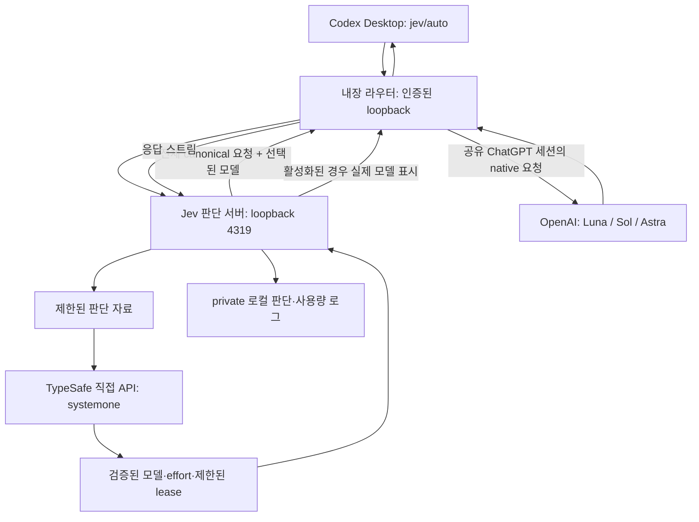

# ZIRU Jev Codex Router

작업의 요구 품질과 실패 위험에 맞춰 모델과 effort를 선택하고, 구현·검증·리뷰·수정을 포함한 전체 토큰 절감을 목표로 하는 라우터입니다.

**비공개 preview · macOS Codex Desktop** · [English](README.md)

## 동작 예시와 기능

선택적 표시를 켜면 첫 응답 텍스트에 `[gpt-6.1-sol / high]`처럼 실제 제공된 모델과 effort를 표시합니다. 추론 시작 전 표시를 보장하지 않으며 구조화 JSON은 제외합니다. 깨끗한 연속 작업은 제한된 lease로 판단을 재사용하고 새 사용자 요청·오류·압축·도구 체인 변경 시 다시 판단합니다.

## 빠른 설치와 첫 실행

macOS, Node.js 22.19 이상, Python 3.11 이상, Codex ChatGPT 로그인, private 저장소 접근 권한, private `.jev.env`의 TypeSafe 키가 필요합니다. 서비스 소스는 내부 디스크의 안정적인 경로에 둡니다.

### Codex에 붙여넣을 설치 프롬프트

```text
https://github.com/zirubak/ziru-jev-codex-router 를 내 Mac에 설치해줘.
먼저 private 저장소에 인증된 접근이 가능한지 확인하고
~/Documents/GitHub/ziru-jev-codex-router 에 clone해줘. 경로가 이미 있으면
기존 변경을 보존해. README와 프로젝트 지침을 읽고 macOS, Node.js 22.19 이상,
Python 3.11 이상, Codex 로그인, 로컬 포트 충돌을 확인해줘.
내 private ~/.jev.env를 JEV_ENV_FILE로 사용해. 키 값은 채팅·명령 인자·Git에
출력하거나 복사하지 마. 파일이 없으면 키 값 대신 파일 위치만 물어봐.
루트 ./install.sh transaction과 내장 router를 사용하고 다른 router를 clone하지 마.
관련 없는 Codex 설정과 기존 서비스를 보존해. 알 수 없는 서비스가 포트를
쓰면 종료시키지 말고 중단해서 알려줘.
문서의 진단과 smoke test로 설치를 검증하고 [모델 / effort] 표시를 켜줘.
검사 결과, 복원 실패 여부와 설치 revision을 보고해줘. Codex 종료·재시작은
내가 하도록 남겨두고 Jev 선택과 일반 모델 복귀 방법을 안내해줘.
health 확인만으로 설치 성공이라고 보고하지 마.
```

### 직접 설치

GitHub CLI에 로그인한 후 실행합니다. private 키 파일은 먼저 편집기로 준비하며 `TYPESAFE_API_KEY` 항목이 있어야 합니다. 키 값은 설치 프롬프트에 넣지 마세요.

```sh
gh repo clone zirubak/ziru-jev-codex-router "$HOME/Documents/GitHub/ziru-jev-codex-router"
cd "$HOME/Documents/GitHub/ziru-jev-codex-router"
chmod 600 "$HOME/.jev.env"
JEV_ENV_FILE="$HOME/.jev.env" ./install.sh
```

설치는 사용량이 발생할 수 있는 실제 smoke 요청을 포함합니다. `./install.sh --prepare-only`는 서비스 활성화 없이 의존성을 준비합니다. 직접 Codex를 종료·재시작하고 **Jev Codex Router**를 선택한 뒤 표시와 진단을 확인합니다.

```sh
touch "$HOME/.codex/codex-router/jev-router.signature"
bin/jev-codex-router router status
bin/jev-codex-router router doctor
bin/jev-codex-router smoke
```

## 모델·effort·fallback

| 자동 후보 | effort |
| --- | --- |
| GPT-6 Luna | low, medium, high, xhigh, max |
| GPT-6.1 Sol | low, medium, high, xhigh, max |
| GPT-6 Astra | low, medium, high, xhigh, max |

프로젝트 아키텍처·독립 최종 코드 리뷰·위험 중심 리뷰는 Astra를 사용하고 effort는 별도로 판단합니다. 기술적인 Jev 오류·키/작업 부재는 **Sol 6.1 / high / Standard**로 fallback합니다. Kill switch·shadow·native 사용량 소진은 별도 기존 정책입니다.

Ultra는 native Sol/Astra에서 사용자가 직접 선택하도록 권고하며 자동 위임 활성화를 주장하지 않습니다. 연구 자료는 판단 참고 근거이며 실제 품질·절감 성과를 보장하지 않습니다.

## 비용과 측정 한계

현재 정책 관측 887회 중 Sol 6.1은 753회, Astra는 134회입니다. 완료된 작업 887개를 뜻하지 않습니다.

| 항목 | 관측 결과 |
| --- | --- |
| 캐시 사용량 관측 | 880회, 미확인 7회 |
| 입력 토큰 | 133,127,030 |
| 입력에 포함된 캐시 토큰 | 41,673,216 (31.3%) |
| Jev 판단 / lease 재사용 | 566 / 321 |
| Jev 관측 입력 토큰 | 1,596,027 |
| 전체 작업 토큰·금액 절감률 | unknown |

lease가 판단 호출 36.2%를 피했다는 결과는 전체 토큰·비용 36.2% 절감을 뜻하지 않습니다. [계산 범위](docs/COSTS.md)를 참고하세요. 구독료·Codex 크레딧·API 환산액·TypeSafe 요금을 구분합니다. 과거 약 60% 시뮬레이션은 [역사적 참고](BACKTEST.md)이며 현재 성과가 아닙니다.

## 구조와 전송 데이터



두 번째 라우터 통과는 native 모델 ID를 사용해 재귀적인 Jev 호출을 피합니다. TypeSafe에는 사용자 텍스트·최근 문맥·도구 발췌를 포함할 수 있는 제한된 판단 자료를 보냅니다. 실행 모델에는 전체 canonical 요청을 전달합니다. Jev는 `https://api.typesafe.ai/v1/systemone`으로 직접 호출하며 Vercel을 사용하지 않습니다. 키·로그·백업은 게시하지 않습니다.

## 문제 해결·제거·출처·기여

```sh
bin/jev-codex-router report --days 7 --policy current
bin/jev-codex-router update
bin/jev-codex-router router providers generic disable jev
```

Jev 비활성화는 다른 provider를 유지합니다. 전체 제거는 다른 클라이언트의 서비스 공유 여부를 확인하고 [운영 안내](server/INSTALL.md)를 따릅니다. 백업 전체를 최신 설정에 덮어쓰지 마세요.

[지원 범위](docs/SUPPORT.md) · [출시 검사](docs/RELEASING.md) · [보안](SECURITY.md) · [기여](CONTRIBUTING.md)


## 플랫폼 한계와 테스트 피드백

이번 preview의 지원 대상은 **macOS Codex Desktop**입니다. 제작자는 Windows
설치와 전체 동작을 수동으로 검증하지 못했습니다. 루트 설치 도구는 macOS의
launchd를 사용하므로 Windows용 설치 도구로 지원하지 않습니다. 내장 router의
이식성 CI와 제품 전체 지원은 별개이며, Windows CI 통과만으로 Windows 설치
지원이 확인되는 것은 아닙니다.

저장소 접근 권한이 있는 Windows 사용자의 테스트와 피드백을 환영합니다.
격리된 환경에서 이식 가능한 `router/` 구성요소를 시험하고
[GitHub Issues](https://github.com/zirubak/ziru-jev-codex-router/issues)에 Windows·
Node.js·Codex 버전, 시험한 commit, 재현 절차, 기대 결과와 실제 결과, 비밀을
제거한 오류를 알려주세요. API 키·인증 파일·원시 대화·설치 백업은 첨부하지
마세요.

## 브랜드 이미지

상단 배너와 아래 공유용 이미지는 README와 저장소에 포함돼 있습니다.
GitHub의 별도 Social preview 설정 적용은 이번 출시의 완료 조건에서 제외합니다.


## 출처와 ZIRU 변경점

[0xNatoshi/jev-codex-router](https://github.com/0xNatoshi/jev-codex-router)를 기반으로 발전시켰으며, base commit은 `8701ef788aa8cb0948f299538747fb01029d32b8`입니다. [MIT 라이선스](LICENSE)와 [embedded router 출처](ROUTER_FORK.md)를 유지합니다.

ZIRU는 연구 기반 모델·effort 판단, 최신 3개 후보, Sol/high 기술적 fallback, 응답 prefix, Ultra 수동 권고와 설치 보호를 보강했습니다.

## ZIRU 블로그

프로젝트의 실험과 AI 코딩 활용 이야기는 [ZIRU의 Medium 블로그](https://medium.com/@jh.baek.sd)에서 읽고 팔로우할 수 있습니다. 코드와 검증 자료에 더해 긴 설명을 확인할 수 있도록 연결했습니다.

Jev만 제거하려면 provider를 비활성화하고 picker를 숨긴 후 Jev 서비스를 중지합니다.

```sh
bin/jev-codex-router router providers generic disable jev
router/bin/control picker set jev/auto hide
launchctl bootout "gui/$(id -u)/com.thibaultsaintjean.jev-router"
```

로그인 시 다시 시작하지 않도록 Label과 소스 경로가 이 설치에 속함을 확인한 후
`~/Library/LaunchAgents/com.thibaultsaintjean.jev-router.plist`만 제거합니다.
전체 Codex 통합 제거는 `bin/jev-codex-router router uninstall`을 사용합니다.
공유 세션도 해제하려면 `bin/jev-codex-router router chatgpt-session disable`을
사용하되, 다른 로컬 클라이언트가 그 세션을 쓰는 경우 영향을 확인하세요.
다른 등록 클라이언트가 남으면 공유 서비스는 보존됩니다. 직접 Codex를 재시작하고
native 모델 선택과 `router status`로 제거를 확인합니다. 키·로그·백업은 삭제하지 않습니다.
