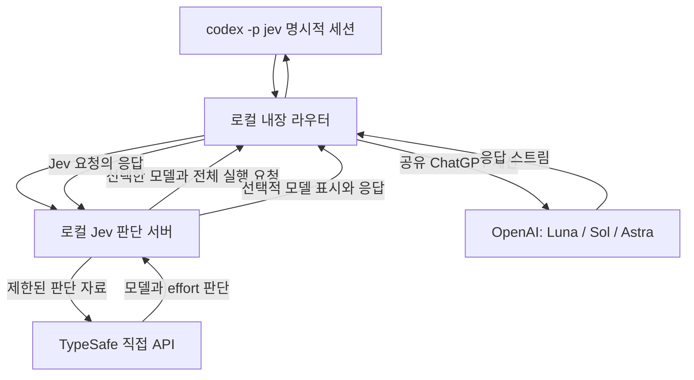

<p align="center"></p>

현재 prerelease: [v0.1.0-preview.3 변경 사항과 한계](docs/release/v0.1.0-preview.3.md). [릴리즈](https://github.com/zirubak/ziru-jev-codex-router/releases/tag/v0.1.0-preview.3)에서 설치·검증 범위를 확인하세요.

# ZIRU Jev Codex Router

**Codex가 작업 단계에 맞는 모델과 추론 깊이를 선택하도록 하세요.**

  · [로컬 릴리즈 검증](docs/release/v0.1.0-preview.3.md#validation)

[English](README.md) · [설치](#설치) · [응답-예제](#이렇게-보입니다) · [동작-구조](#동작-구조) · [프로젝트에 스타 남기기](https://github.com/zirubak/ziru-jev-codex-router/stargazers)

ZIRU는 `codex -p jev` 명시적 프로필로 **Jev Codex Router**를 제공합니다. 이 프로필을 선택하고 평소처럼 질문하거나, 버그를 고치거나, 기능을 만들어 달라고 요청하면 됩니다. TypeSafe의 Jev가 **GPT-6 Luna, GPT-6.1 Sol, GPT-6 Astra** 중 사용할 모델과 추론 깊이인 *effort*를 정합니다.

목표는 필요한 품질을 확보하면서 코딩·검사·리뷰·수정에 드는 불필요한 토큰 사용을 줄이는 것입니다. 버튼 문구를 바꾸는 일과 최종 보안 리뷰에는 서로 다른 접근이 필요하니까요.

## 격리된 프로필을 선택하세요

1. 아래 루트 설치기로 설치합니다.
2. `codex -p jev`를 실행하여 Jev 모델과 전용 로컬 제공자를 함께 선택합니다.
3. 평소처럼 요청합니다. 표시 기능을 켜면 실제 모델·effort 라벨을 확인할 수 있습니다.

일반 Codex와 Desktop 모델 목록은 공식 OpenAI/ChatGPT 제공자와 목록을 유지합니다.
설치기는 전역 `openai_base_url`이나 모델 목록을 바꾸지 않습니다. 기존 대화는
저장된 모델·제공자를 유지하므로 일반 사용은 새 공식 모델 대화에서 확인하세요.
자세한 설정·복구·검증은 [제공자 격리 안내](docs/release/provider-isolation.md)를 참고하세요.

기존 effort 메뉴를 유지하는 [Desktop 연결 후보](docs/release/native-desktop-bridge.md)도
별도로 준비했습니다. Auto는 화면 effort를 무시하고 Jev가 결정하며 Manual은 선택값을
적용합니다. 사용자가 2026-10-02 새 Desktop 세션에서 전환과 effort 슬라이더의 정상 동작을 확인했습니다. 일반 설치로 활성화되지 않습니다.

알려진 제한: Jev를 선택하면 Desktop의 Plan 선택이 초기화되는 문제가 아직 열려 있습니다.
[추적 이슈 #30](https://github.com/zirubak/ziru-jev-codex-router/issues/30)을 확인하세요.

## Desktop에서 라우팅 모드 선택하기

선택형 Desktop 연결은 모델 메뉴에 다음 네 항목을 추가합니다.

| 항목 | 모델 선택 | effort 선택 |
| --- | --- | --- |
| Jev Codex Router Auto | Jev가 결정 | Jev가 결정하며 화면 슬라이더 값은 무시 |
| Jev Codex Router Manual | Jev가 호환 모델을 결정 | 사용자가 선택한 low·medium·high·xhigh·max 유지 |
| Jev Sol Router | 사용자가 GPT-6.1 Sol 선택 | Jev가 결정하며 화면 슬라이더 값은 무시 |
| Jev Astra Router | 사용자가 GPT-6 Astra 선택 | Jev가 결정하며 화면 슬라이더 값은 무시 |

실제 설치에 사용하는 고정 checkout에서 `./install.sh --desktop`을 실행하세요.
작업을 저장하고 Codex를 직접 종료한 다음 생성된 실행기를 여세요.

```sh
open "$HOME/.codex/codex-router/desktop/Jev Codex.command"
```

위 경로는 기본 상태 디렉터리를 기준으로 합니다. 별도 경로를 설정했다면 설치기가
알려준 경로를 사용하세요. 설치하면 GUI 세션에 bridge가 등록되어 원래 앱 아이콘으로
열거나 updater가 다시 실행해도 같은 연결을 사용합니다. 서명된 앱이 변경되면 새 빌드의
native contract를 자동으로 다시 검증합니다. 신뢰된 앱 빌드의 contract 불일치만 native
복구 전용 Jev provider를 사용합니다. 저장된 Jev 대화 기록은 읽을 수 있지만 Jev 추론은
거부됩니다. 서명, 신뢰, artifact, 작업, 시간 초과 또는 정리 검증에 실패하면 앱 실행을
중단합니다. hard stop 뒤에 native 전용 실행을 복구하려면 GUI override를 제거하세요.

```sh
python3 server/desktop_session.py deactivate "$HOME/.codex/codex-router/desktop/manifest.json"
```

상태 디렉터리를 다르게 설정했다면 설치기가 알려준 manifest 경로를 사용하세요. 공식 모델은
기존 provider와 기본 설정을 유지합니다.
[업데이트 검증과 복구 안내](docs/release/native-desktop-bridge.md)를 참고하세요.

## 기존 설치 업데이트

실제 설치에 사용하는 고정 checkout에서 실행하세요.

```sh
bin/jev-codex-router update
```

업데이트는 `main`의 최신 소스를 가져오고 루트 설치 트랜잭션을 실행합니다.
특정 preview tag에 고정하는 명령은 아닙니다. 업데이트 후 Desktop 실행기를 활성화하거나
갱신하려면 `./install.sh --desktop`을 별도로 실행하세요. updater는 `--desktop`을
전달하지 않습니다. 준비가 되면 Desktop을 직접 종료하고 다시 여세요.

[preview.3 변경 사항과 알려진 한계](docs/release/v0.1.0-preview.3.md),
[진단·복구 안내](server/INSTALL.md)를 참고하세요.

### Codex에게 업데이트 맡기기

Jev를 설치한 Mac의 Codex에 아래 프롬프트를 복사해 넣으세요.

```text
https://github.com/zirubak/ziru-jev-codex-router 의 기존 ZIRU Jev Codex Router
설치를 업데이트해 줘.

설치된 서비스가 사용하는 checkout을 찾고 해당 AGENTS.md와 업데이트 안내를 읽어.
업데이트 전에 remote, 현재 commit, 작업 트리 변경과 앱 호환성을 확인해.
로컬 변경·개인 관측 코드·인증 정보·무관한 Codex 설정·보호 백업을 보존해.
--force를 쓰거나 변경을 버리거나 새 clone으로 기존 checkout을 교체하지 마.
로컬 변경 때문에 안전하게 업데이트할 수 없으면 충돌 파일과 필요한 결정을 보고하고
그 파일을 바꾸기 전에 멈춰.

문서의 main 업데이트 명령 bin/jev-codex-router update를 사용해.
이 명령은 최신 release tag에 고정하는 설치가 아니므로 최신 릴리즈와 실제 설치 commit을
구분해 보고해. 선택형 Desktop 실행기가 이미 설치돼 있으면 루트
./install.sh --desktop 트랜잭션으로 갱신해. 사용하지 않던 Desktop 연결은 추가하지 마.

문서의 status·doctor·smoke 검사를 실행해. smoke는 사용량을 소비할 수 있어.
실행한 검사, 실패, 설치 commit과 실행기 경로를 보고해.
실행 중인 Desktop에 업데이트가 로드됐다고 단정하지 마.
비밀 출력·역사적 config 전체 복원·앱 패치·Desktop 종료/재시작은 하지 마.
마지막에 내가 작업을 저장하고 Command+Q로 Codex를 완전히 종료한 뒤,
Desktop 연결을 사용한다면 검증된 Jev 실행기로 다시 여는 방법을 알려줘.
```

### Desktop 재실행은 직접 마무리하세요

작업을 저장한 뒤 **Command+Q**로 Codex 앱을 완전히 종료하세요. 창만 닫는 것으로는
충분하지 않습니다. 정상 종료되지 않을 때만 저장 가능한 작업을 저장하고 macOS
**강제 종료**(**Option+Command+Escape**)를 사용하세요. 매번 강제 종료할 필요는 없습니다.

Desktop 연결을 사용한다면 설치기가 알려준 `Jev Codex.command`로 다시 열어 호환성을
확인하고 GUI 세션의 bridge 등록을 복원하세요. 이후에는 원래 앱 아이콘으로 열어도 같은
연결이 사용됩니다. 기본 상태 디렉터리에서는 다음 명령을 사용합니다.

```sh
open "$HOME/.codex/codex-router/desktop/Jev Codex.command"
```

CLI 프로필만 사용한다면 새 `codex -p jev` 세션을 시작하세요.

## 설치

현재는 **macOS Codex Desktop용 공개 preview**입니다. 정상적인 Codex ChatGPT 로그인, Node.js **22.19 이상**, Python **3.11 이상**, [TypeSafe API 키](https://console.typesafe.ai/keys)가 필요합니다.

### 먼저, Jev에게 작은 열쇠 하나

API 키는 **Jev를 사용할 수 있는 나만의 열쇠**라고 생각하면 됩니다. 보관함은 Mac의 **`~/.jev.env`**라는 작은 텍스트 파일입니다. 프로젝트 폴더 안에 넣지 않습니다.


**1. 열쇠를 받으세요.** [TypeSafe 키 발급 페이지](https://console.typesafe.ai/keys)를 열고 로그인하거나 계정을 만듭니다. API 키를 생성하고 다음 단계에서 사용할 수 있게 복사하세요. [공식 빠른 시작 문서](https://docs.typesafe.ai/introduction/quickstart)가 안내하는 페이지이며, 버튼 이름은 바뀔 수 있습니다.

**2. 열쇠 보관함을 만드세요.** Mac에서 `Command + Space`를 누르고 `Terminal`을 검색한 뒤 Return을 눌러 **터미널**을 엽니다. 다음 명령을 한 줄씩 실행하세요. 이 명령에는 키를 넣지 않습니다.

```sh
touch "$HOME/.jev.env"
chmod 600 "$HOME/.jev.env"
nano "$HOME/.jev.env"
```

`touch`는 파일이 없으면 만들고, 기존 파일의 내용은 지우지 않습니다. `chmod 600`은 내 Mac 사용자만 읽고 쓸 수 있게 합니다. `nano`는 터미널 안에서 일반 텍스트 편집기를 엽니다.

편집 화면에 다음 설정 이름을 적으세요.

```text
TYPESAFE_API_KEY=
```

**같은 줄의 `=` 바로 뒤에** 복사한 키를 붙여넣으세요. 값이 빈 상태로 두면 작동하지 않습니다. 이 설정이 이미 있다면 값만 바꾸고 다른 설정은 보존하세요. `export`나 추가 공백, 두 번째 줄은 필요하지 않습니다.

**Control + O → Return**으로 저장하고, **Control + X**로 나옵니다. 여기서는 Command가 아니라 **Control** 키입니다.

`~`는 내 홈 폴더, 이름 앞의 점은 숨김 파일이라는 뜻입니다. 실제 위치는 `/Users/내_MAC_사용자명/.jev.env`와 같습니다. 파일명은 **`.jev.env`** 그대로 사용하세요. **`.jev.env.txt`는 다른 파일**입니다. 이미 잘 쓰는 파일이 있다면 그대로 두고 새로 만드는 단계는 건너뛰세요.

**3. 나머지는 Codex에게 맡기세요.** 아래 설치 프롬프트를 붙여넣고 파일이 준비됐다고만 알려주세요. **키 자체는 채팅·이슈·터미널 명령에 붙여넣지 않습니다.** 설치 도구가 파일을 확인하고 실제 smoke 요청으로 연결을 검사합니다. 이제 재미있는 것을 만드는 일로 돌아가면 됩니다.

서비스는 설치한 소스 폴더를 계속 사용하므로 내부 디스크의 고정된 경로에 설치합니다.

### Codex에 설치를 맡기기

아래 프롬프트를 Codex에 붙여넣으세요.

```text
https://github.com/zirubak/ziru-jev-codex-router 를 내 Mac에 설치해줘.
먼저 README와 프로젝트 지침을 읽어줘. 인증된 저장소 접근을 확인하고
~/Documents/GitHub/ziru-jev-codex-router 에 clone하되 기존 폴더와 변경은 보존해.
macOS, Node.js 22.19 이상, Python 3.11 이상, Codex 로그인과 필요한 포트를 확인해.
내 개인 ~/.jev.env를 JEV_ENV_FILE로 사용해. 키 값을 채팅·명령 인자·Git에
출력하거나 복사하지 마. 파일이 없으면 개인 파일의 위치를 물어보고,
아직 키가 없으면 발급 방법을 안내해줘.
내장 router와 실패 복원 기능을 사용하는 루트 ./install.sh로 설치해.
관련 없는 설정과 서비스를 보존하고, 모르는 서비스가 포트를 쓰면 종료하지
말고 중단해서 알려줘.
[모델 / effort] 표시를 켜고 문서의 status, doctor, smoke 검사를 실행해.
health 확인만으로 설치 성공이라고 판단하지 마.
설치한 revision, 검사 결과와 복원 실패 여부를 보고해줘.
Codex를 재시작하지 말고 codex -p jev 선택 방법과
새 일반 모델 대화의 공식 경로 확인 방법을 알려줘.
```

설치에는 사용량이 발생할 수 있는 실제 smoke 요청이 포함됩니다. 앱은 자동 재시작하지 않습니다.

<details>
<summary><strong>터미널에서 직접 설치하려면</strong></summary>

먼저 GitHub CLI에 로그인하고 개인 키 파일을 준비합니다. 설치 폴더가 이미 있다면 내용을 확인한 뒤 진행하세요.

```sh
gh repo clone zirubak/ziru-jev-codex-router "$HOME/Documents/GitHub/ziru-jev-codex-router"
cd "$HOME/Documents/GitHub/ziru-jev-codex-router"
chmod 600 "$HOME/.jev.env"
JEV_ENV_FILE="$HOME/.jev.env" ./install.sh
```

저장소 루트에서 모델 표시를 켜고 설치를 확인합니다.

```sh
touch "$HOME/.codex/codex-router/jev-router.signature"
bin/jev-codex-router router status
bin/jev-codex-router router doctor
bin/jev-codex-router smoke
```

`codex -p jev`로 **Jev Codex Router**를 명시적으로 선택합니다. 서비스를 활성화하지 않고 의존성만 준비하려면 `./install.sh --prepare-only`를 사용하세요. 설치 세부 사항과 복구 방법은 [운영 안내](server/INSTALL.md)에 있습니다.

</details>

## 네 선택 모드

격리된 Jev 프로필에 네 경로가 있습니다. `codex -p jev`는 Auto를 선택합니다.
`codex -p jev -m jev/manual -c model_reasoning_effort=high`는 일반 모드의 High를 선택합니다.

| 경로 | 광고된 effort | 동작 |
| --- | --- | --- |
| Jev Codex Router by Auto (`jev/auto`) | Auto 하나 | Jev가 모델과 effort 선택 |
| Jev Codex Router (`jev/manual`) | low (Light), medium, high, xhigh, max | Jev가 모델 선택, 코드는 사용자 effort 유지 |

일반 모드는 effort 누락 시 medium을 사용하며 잘못된 값은 inference 전에 거부합니다.
캐시 전환·재시도·fallback에서 선택을 유지합니다. Auto의 선택 sentinel은 실행 모델에
전달하지 않습니다. Jev 기술 오류 시 Auto는 Sol 6.1/high, 일반 모드는 Sol 6.1/선택 effort를
사용합니다. 같은 effort를 지원하는 quota fallback이 없으면 명확한 오류를 반환합니다.
두 경로 모두 Plan 품질·검토 지침을 유지하며 Ultra는 제외합니다. Native Desktop 메뉴의
실제 표시는 미검증이고, 일반 Desktop은 기본 공급자와 catalog를 유지합니다.
[릴리즈 검증 기록](docs/release/selection-modes.md)을 참고하세요.

Sol(`jev/sol`)과 Astra(`jev/astra`)는 설계·최종·위험 리뷰에서도 선택 모델을
유지하며 Jev가 effort만 정합니다. Jev 판단·응답 검증 오류나 키·작업 부재 시
같은 모델/high로 실행합니다. 한도 소진·실행 실패 시 다른 모델로 전환하지 않습니다.
자동 quota 상태는 요청당 한 번 native에서 재확인하며 수동 dry 표시는 유지합니다.
Kill switch는 Jev 호출 없이 선택 모델/high, shadow는 판단을 기록하고 선택 모델/high를
실행합니다. 동시에 켜지면 kill switch가 우선합니다. Ultra 자동 실행·권고는 추가하지 않습니다.

설치기는 기존 provider 등록을 네 개로 이전합니다. 설치 후
`python3 server/smoke.py --route sol`과 `--route astra`로 실제 모델을 검사합니다.
[고정 모델 검증 범위](docs/release/fixed-model-routes-2026-10-10.md)를 참고하세요.

## 이렇게 보입니다

아래는 응답 형식을 설명하는 예제이며, **실제 실행 기록이나 특정 모델 선택을 보장하는 결과가 아닙니다.** 문맥과 도구 결과에 따라 선택이 달라집니다. 본문은 Codex가 작성하며, Jev는 모델과 effort를 정합니다. 판단 이유 전체가 자동으로 표시되지는 않습니다.

**간단한 수정**

> 저장 버튼을 변경사항 저장으로 바꿔줘. 대화상자에서 잘 보이는지도 확인해줘.

```text
[gpt-6-luna / low]

버튼 문구를 수정하고 대화상자의 배치를 확인하겠습니다.
```

**원인 분석이 필요한 버그**

> 이 API가 가끔 중복 레코드를 반환해. 원인을 찾고, 실패하는 검사를 만든 다음 고쳐줘.

```text
[gpt-6.1-sol / high]

중복 반환을 재현하고 쿼리와 재시도 경로를 추적한 뒤,
회귀 검사로 수정 결과를 확인하겠습니다.
```

**완성된 코드의 최종 리뷰**

> 완성된 로그인 변경을 정확성과 보안 관점에서 리뷰해줘. 문제가 있으면 파일 위치도 알려줘.

```text
[gpt-6-astra / high]

인증 경계와 실패 경로를 확인하고, 발견한 문제를 파일 위치와 함께
심각도순으로 정리하겠습니다.
```

라벨은 각 assistant 메시지의 첫 텍스트와 함께 표시되며, 모델이 추론을 시작하기 전에 미리 표시되지는 않습니다. 구조화된 JSON 출력에는 붙이지 않습니다. 도구를 실행하거나 새 요청을 보낸 뒤에는 다른 모델과 effort가 표시될 수 있습니다.

## 모델을 고르는 기준

*Effort*는 모델이 얼마나 깊게 추론할지 정하는 설정입니다. Jev는 남은 작업, 실패 위험, 확보한 근거를 보고 판단하며, 프로젝트의 [라우팅 정책](server/routing_policy.py)과 [연구 참고 자료](server/routing_reference.py)를 사용합니다.

| 자동 후보 | 주로 맡는 작업 | 선택 가능한 effort |
| --- | --- | --- |
| GPT-6 Luna | 결과를 쉽게 확인할 수 있는 작은 수정 | low · medium · high · xhigh · max |
| GPT-6.1 Sol | 일반적인 구현과 디버깅 | low · medium · high · xhigh · max |
| GPT-6 Astra | 아키텍처, 독립 최종 리뷰, 위험 중심 리뷰 | low · medium · high · xhigh · max |

현재 정책은 위 리뷰·아키텍처 범주에 Astra를 사용하고, effort는 별도로 판단합니다. 문제가 없는 연속 작업에서는 판단을 제한적으로 재사용합니다. 새 사용자 요청, 오류, 문맥 압축, 도구 체인 변경이 있으면 다시 판단합니다.

**Jev에 기술적인 오류가 생기거나 키·작업 정보가 없으면** **GPT-6.1 Sol / high / Standard**로 실행을 이어갑니다. Sol/high 라벨만으로 정상 선택과 오류 시 대체 실행을 구분할 수는 없으며, 로컬 진단에서 확인할 수 있습니다. Kill switch, shadow mode, 모델 사용량 소진에는 [별도 처리](server/INSTALL.md)가 적용됩니다.

네이티브 Plan 모드에서는 구현 가능한 계획의 품질을 우선하고, 불확실성·의존성·실패 영향·후속 수정 비용에 따라 Jev가 모델과 추론 effort를 선택합니다. 중요한 계획에는 독립 검토를, 필요한 경우 허용된 에이전트 협력을 권고합니다. 검토 안내는 위임 권한이나 검토 완료 증거를 만들지 않으며 Ultra를 자동으로 선택하지 않습니다. 승인된 계획의 단순 문구 수정은 가벼운 경로를 사용할 수 있습니다. [Plan 정책과 검증 기록](docs/release/adaptive-planning.md)을 참고하세요.

**Ultra는 사용자가 직접 선택합니다.** 독립적인 작업을 병렬로 나누면 도움이 될 때 라우터가 일반 Sol 또는 Astra 모델의 Ultra를 선택하도록 권할 수 있습니다. 현재 권고 문구는 한국어입니다. 권고만으로 모드가 바뀌거나 위임이 켜지지는 않으며, 클라이언트 지원과 위임 권한이 필요합니다. Ultra는 토큰을 더 사용할 수 있습니다.

## 비용은 얼마나 줄어드나요?

절감이 목표지만, **현재 정책의 신뢰할 수 있는 절감률은 아직 없습니다.** 일부 요청은 작은 모델이나 낮은 effort로 사용량을 줄일 수 있지만, 추가 추론·재시도·Jev 판단 비용이 생길 수도 있습니다. 비교해야 할 것은 필요한 품질로 전체 작업을 마치는 데 드는 비용입니다.

2026-10-01 관측 자료에는 **라우팅 호출 887회**가 있습니다. 완료된 작업 887개라는 뜻은 아닙니다.

| 측정 항목 | 관측 결과 |
| --- | --- |
| 모델 선택 | Sol 6.1: 753회 · Astra: 134회 |
| Jev 판단 / 판단 재사용 | 566회 / 321회 |
| 사용량이 관측된 880회의 입력 토큰 | 133,127,030개, 이 중 캐시 토큰 41,673,216개 |
| 관측된 Jev 입력 토큰 | 1,596,027개 |
| 전체 작업 토큰 절감률 / 금액 절감률 | 미확인 / 미확인 |

판단을 321회 재사용해 라우팅 호출의 36.2%에서 Jev 호출을 줄였습니다. **토큰이나 비용을 36.2% 절감했다는 뜻은 아닙니다.** 7회는 캐시 사용량이 기록되지 않았고, 요율과 작업 단위 측정도 불완전합니다. [측정 범위와 계산 방법](docs/COSTS.md)을 참고하세요.

Codex 구독료, 사용량 크레딧, API 환산액, TypeSafe 요금은 별개입니다. 사용량이 줄어도 정액 월 구독료가 낮아지지는 않습니다. 과거 [약 60% 시뮬레이션](BACKTEST.md)은 역사적 참고 자료이며 현재 정책의 성과가 아닙니다.

## 동작 구조



TypeSafe에는 사용자 텍스트, 최근 문맥, 도구 결과 발췌가 포함될 수 있는 **분량이 제한된 판단 자료**를 보냅니다. 선택된 OpenAI 모델에는 **전체 canonical 실행 요청**을 전달하므로, 실행 문맥을 이 판단 자료로 대체하지 않습니다. 두 번째 라우터 통과에서는 일반 모델 ID를 사용해 Jev가 재귀적으로 호출되지 않도록 합니다.

Jev 요청은 `https://api.typesafe.ai/v1/systemone`으로 직접 보내며 Vercel을 거치지 않습니다. 로컬 서비스는 loopback 주소에서 동작합니다. 인증 정보와 판단·사용량 로그는 로컬에 저장됩니다. 이 파일이나 설치 백업을 게시하지 마세요. [보안 안내](SECURITY.md)에서 자세히 설명합니다.

## 도움말과 문서

모델이 보이지 않거나 요청이 실패하면 `bin/jev-codex-router router doctor`부터 확인하세요. [운영 안내](server/INSTALL.md)에 진단, 업데이트, Jev 비활성화, 전체 제거, 공유 서비스 주의 사항과 설치 복구 방법이 있습니다.

| 문서 | 내용 |
| --- | --- |
| [운영 안내](server/INSTALL.md) | 설치·진단·업데이트·제거 |
| [지원 범위](docs/SUPPORT.md) | 지원 환경과 검증 한계 |
| [비용](docs/COSTS.md) | 측정한 항목과 아직 모르는 항목 |
| [기여](CONTRIBUTING.md) | 검사와 기여 방법 |
| [출시](docs/RELEASING.md) | 출시 검사·게시된 preview·검증 한계 |

**Windows는 검증하지 못했습니다.** 제작자는 Windows 설치와 전체 동작을 시험하지 못했습니다. 루트 설치 도구는 macOS launchd를 사용하며, 이식 가능한 `router/`의 CI가 Windows 제품 지원을 뜻하지는 않습니다. Windows 사용자가 격리된 환경에서 해당 구성요소를 시험하고 [피드백](https://github.com/zirubak/ziru-jev-codex-router/issues)을 남겨주시면 도움이 됩니다. OS·Node.js·Codex 버전, commit, 재현 절차와 비밀을 제거한 오류를 포함해주세요. 키·인증 파일·원시 대화·백업은 첨부하지 마세요.

## 출처와 ZIRU

[0xNatoshi/jev-codex-router](https://github.com/0xNatoshi/jev-codex-router)의 commit `8701ef788aa8cb0948f299538747fb01029d32b8`을 기반으로 만들었습니다. 원본 MIT 저작권·허가문은 [LICENSE](LICENSE)에 유지하며, 내장 라우터의 출처와 별도 라이선스는 [ROUTER_FORK.md](ROUTER_FORK.md)에 기록했습니다.

ZIRU는 연구 자료를 반영한 라우팅 정책, 현재의 세 모델 후보, Sol/high 기술적 fallback, 응답의 모델 표시, Ultra 수동 권고와 설치 보호 기능을 더했습니다.

프로젝트를 만들며 얻은 실험 결과와 AI 코딩 활용 이야기는 [ZIRU의 Medium 블로그](https://medium.com/@jh.baek.sd)에서 읽을 수 있습니다. 저장소에는 [프로젝트 공유용 이미지](docs/assets/social-preview.png)도 포함되어 있습니다.
