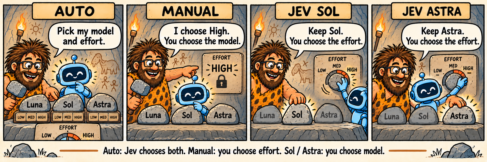
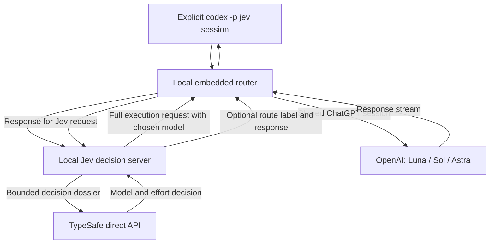

<p align="center"></p>

Current public prerelease: **[v0.1.0-preview.3](https://github.com/zirubak/ziru-jev-codex-router/releases/tag/v0.1.0-preview.3)** — gateway security hardening, dependency updates and four routing modes. [Changes, validation and known limits](docs/release/v0.1.0-preview.3.md).

# ZIRU Jev Codex Router

**Let Codex choose the model and thinking effort for each stage of your work.**

  · [Local release validation](docs/release/v0.1.0-preview.3.md#validation)

[한국어](README.ko.md) · [Install](#install) · [Examples](#what-youll-see) · [How it works](#how-it-works) · [Star this project](https://github.com/zirubak/ziru-jev-codex-router/stargazers)

ZIRU exposes **Jev Codex Router** through the explicit `codex -p jev` profile. Select that profile and keep working as usual: ask a question, fix a bug, or build a feature. In Auto, Jev from TypeSafe chooses between **GPT-6 Luna, GPT-6.1 Sol and GPT-6 Astra**, along with how deeply the model should reason. Manual keeps the effort you select; Jev Sol and Jev Astra keep the model you select.

The aim is to use enough reasoning to do the job well, while avoiding unnecessary token use across coding, tests, reviews and corrections. A small edit and a final security review should not need the same approach.

## Select an isolated profile

1. Install with the root installer below.
2. Run `codex -p jev` to select the Jev model and its dedicated local provider together.
3. Send your usual prompts. With route display enabled, replies include `[gpt-6.1-sol / high]`.

Normal Codex and the Desktop model picker keep their official OpenAI/ChatGPT
provider and catalog. The standard installation exposes Jev through an explicitly selected
profile; the installer does not override `openai_base_url` or the global
model catalog. Existing threads retain their provider/model identity. Start a
fresh official-model thread for normal use.

See [provider isolation](docs/release/provider-isolation.md) for configuration,
recovery and verification details.

The optional [Desktop integration](docs/release/native-desktop-bridge.md)
adds the four routing modes below and keeps the existing effort menu. Enable it
with `./install.sh --desktop`; the standard installation enables the CLI profile.
Desktop integration is build-specific and checks the native contract at launch.

**Known Desktop limitation:** selecting Plan can reset in the UI
([issue #30](https://github.com/zirubak/ziru-jev-codex-router/issues/30)).
Native Plan transport checks do not establish that this UI behavior is fixed.

## Choose a routing mode in Desktop

The optional Desktop integration adds these entries to the model menu:

| Entry | Model selection | Effort selection |
| --- | --- | --- |
| Jev Codex Router Auto | Jev chooses | Jev chooses; the displayed slider is ignored |
| Jev Codex Router Manual | Jev chooses a compatible model | Your selected low, medium, high, xhigh or max |
| Jev Sol Router | You select GPT-6.1 Sol | Jev chooses; the displayed slider is ignored |
| Jev Astra Router | You select GPT-6 Astra | Jev chooses; the displayed slider is ignored |

### Choose what you control

**Auto: Jev chooses both. Manual: you choose effort. Jev Sol / Jev Astra: you choose the model.**
*Effort* controls how deeply the model reasons before answering. Higher effort
does not guarantee a correct answer or a larger model.



*Illustration of the controls, not a product screenshot or a guaranteed route. Jev Sol and Jev Astra ignore the effort slider; Jev chooses their actual effort.*

### Auto: describe the work

Choose **Jev Codex Router Auto** and ask normally. Jev considers difficulty,
failure risk and remaining work, then chooses Luna, Sol or Astra together with
an effort from low through max. The choice can change on continuations after tools.

“Change this button label” and “Find and fix this login-permission bug” need
different judgments. Auto chooses a combination for the work. These are examples,
not fixed task-to-model rules or guaranteed routes.

**The slider can show High while Auto actually runs low.** Auto ignores the
slider's effort setting and makes its own choice. Start with Auto when you want
to describe the task without managing reasoning depth yourself.

### Manual: delegate the model, set the depth

Choose **Jev Codex Router Manual**, set an effort, then send your request.
Jev selects a model supporting that effort; execution preserves your selected
effort. **Manual does not mean manually picking Luna, Sol or Astra.**

| Effort | Example reason to choose it |
| --- | --- |
| low / Light | Keep reasoning light for a small, clearly scoped task |
| medium | Keep a fixed middle depth while working |
| high | Request deeper reasoning for investigation or review |
| xhigh / max | Explicitly request a higher depth for work you judge needs it |

These are selection examples, not performance or cost guarantees. Higher effort
can increase reasoning tokens or waiting time. If Max is missing, check Settings
→ Configuration → Codex → Model features → Available reasoning efforts on a
supported app build.

For “Investigate this bug with High effort,” choose **Manual + High**. A Sol
selection runs Sol/high; an Astra selection runs Astra/high. **High does not pin
Astra.** Wait for the current response to finish before changing effort for the
next request. To keep a model while Jev adapts effort, choose **Jev Sol Router**
or **Jev Astra Router**. Choose an official model entry for ordinary Codex
controls without Jev routing.

### Jev Sol / Jev Astra: keep the model, delegate depth

Choose **Jev Sol Router** for GPT-6.1 Sol or **Jev Astra Router** for GPT-6 Astra.
Jev chooses effort for each request, including tool continuations. The slider
is ignored, just as in Auto; these routes preserve your model choice even for
architecture and final reviews.

For “Keep Sol while you investigate and fix this bug,” choose **Jev Sol Router**.
The route may move from Sol/high to Sol/low as the work changes. These are
illustrations, not promised choices. A Jev decision failure uses that same
model/high; a model execution failure or exhausted quota does not switch to
another model. [Fixed-route behavior and evidence](docs/release/fixed-model-routes-2026-10-10.md).

### Examples: which mode should I choose?

**Example 1 — a small edit, without managing settings**

Select **Auto**, then send:

> Change the Save button label to Save changes. Keep the existing behavior and check the layout.

You specify the outcome; Jev chooses both model and effort. An illustrative
reply label might be `[gpt-6-luna / low]`, but the context can lead to another
choice. Leaving the slider at High does not force High in Auto.

**Example 2 — investigate a bug at a depth you choose**

Select **Manual**, set the effort slider to **High**, then send:

> Find why this login request sometimes returns 401. Reproduce the failure, fix its cause, and run the affected tests.

Jev still chooses the model. If it chooses Sol, the route is Sol/high; if it
chooses Astra, it is Astra/high. Subsequent tool continuations can change models,
while the effort you selected remains High. Typing “High” in a prompt is not the
Manual setting: choose the mode and use the effort control before sending.

**Example 3 — the same request, four different controls**

> Review this patch for permission bugs and missing regression coverage.

| What you select | Who chooses the model? | Who chooses effort? |
| --- | --- | --- |
| Auto, even with High visible in the slider | Jev, under the route policy | Jev; actual effort may differ from the slider |
| Manual + High | Jev, under the route policy | You; the selected effort stays High |
| Jev Sol Router | You; GPT-6.1 Sol stays selected | Jev; the slider is ignored |
| Jev Astra Router | You; GPT-6 Astra stays selected | Jev; the slider is ignored |

Use Auto when you want the router to adjust depth as the work changes. Use
Manual when keeping a particular reasoning depth matters to you. A mandatory
review policy can constrain the model in either mode; Manual does not remove
that policy or choose a fixed model. Jev Sol and Jev Astra keep the selected
model while adapting effort. High is a setting, not proof that a review
was performed or that the result is correct.

These labels and scenarios explain the controls; they are not recorded runs,
fixed route promises or measured quality/cost comparisons.

### Common questions

- Moving the slider in Auto does not override Jev. Select Manual to apply it.
- Manual can change models while keeping your effort. An incompatible route is not silently served at a lower effort.
- Auto's technical fallback for Jev communication/validation errors is Sol/high. Manual retains your selected effort. Kill switch, shadow and quota policies are separate.
- None of the four modes automatically enables Ultra. Auto/Manual may suggest a native Ultra option; fixed-model routes do not add that advice. A recommendation does not grant delegation authority or replace your choice.
- The response's `[model / effort]` label describes the selected route. UI settings or a model's self-description alone do not establish execution identity. Missing or conflicting returned metadata prevents treating the label as backend-confirmed identity.

From your stable installation checkout, run `./install.sh --desktop`. Save your
work, quit Codex yourself, then open the generated launcher:

```sh
open "$HOME/.codex/codex-router/desktop/Jev Codex.command"
```

That path assumes the default state directory. Use the installer-reported path
if you configured another one. Installation also registers the bridge for
ordinary app launches and updater relaunches in your GUI session. A changed
signed app is automatically tested against the native contract. A verified
contract mismatch uses native recovery-only Jev providers: saved Jev chats
remain readable, but Jev inference is refused. Signature, trust, artifact,
operational, timeout, or cleanup failures stop the launch. To restore native-only
launches after a hard stop, remove the GUI override:

```sh
python3 server/desktop_session.py deactivate "$HOME/.codex/codex-router/desktop/manifest.json"
```

Use the installer-reported manifest path if you configured another state
directory. Official models retain their native provider and defaults.
See [update qualification and recovery](docs/release/native-desktop-bridge.md).

## Update an existing installation

Run from the stable checkout used by your installation:

```sh
bin/jev-codex-router update
```

The updater follows `main` and reruns the root installation transaction; it does
not pin this preview tag. To opt into or refresh the Desktop launcher after the
update, run `./install.sh --desktop` separately. The updater does not forward
`--desktop`. Quit and reopen Desktop yourself when ready.

See the [preview.3 changes and known limits](docs/release/v0.1.0-preview.3.md)
and [diagnostics and recovery](server/INSTALL.md).

### Ask Codex to update it

Paste this into Codex on the Mac where Jev is installed:

```text
Update my existing ZIRU Jev Codex Router installation from
https://github.com/zirubak/ziru-jev-codex-router.

Find the checkout used by the installed services and read its AGENTS.md and
update instructions. Confirm the remote, current commit, working-tree changes,
and app compatibility before updating. Preserve local changes, private observer
code, credentials, unrelated Codex settings and protected backups. Do not use
--force, discard changes or replace the checkout with a new clone. If local
changes prevent a safe update, report the conflicting files and the decision
needed before changing them.

Use bin/jev-codex-router update for the documented main-branch update. This is
not an installation pinned to the latest release tag; report the latest release
and the actual installed commit separately. If the optional Desktop launcher is
already installed, refresh it with the root ./install.sh --desktop transaction.
Do not add Desktop integration if it was not enabled.

Run the documented status, doctor and smoke checks; the smoke may consume usage.
Report which checks ran, failures, the installed commit and the launcher path.
Do not claim the running Desktop has loaded the update yet. Do not print secrets,
restore a historical config wholesale, patch the app or stop/restart Desktop.
Finish with instructions for me to save my work, fully quit Codex with Command+Q,
and reopen it using the verified Jev launcher if Desktop integration is enabled.
```

### Finish the Desktop update yourself

Save your work, then press **Command+Q** to quit Codex completely. Closing only
its window is not enough. If it will not quit normally, use macOS **Force Quit**
(**Option+Command+Escape**) after saving any work you can. Force Quit is a last
resort, not a required step for every update.

For Desktop integration, reopen the installer-reported `Jev Codex.command`
launcher to verify compatibility and restore the GUI session override.
Subsequent ordinary launches use the same integration. With the default state directory:

```sh
open "$HOME/.codex/codex-router/desktop/Jev Codex.command"
```

If you only use the CLI profile, start a new `codex -p jev` session instead.

## Install

This is a **public source preview for macOS Codex Desktop**. Install through the
root transaction below. No signed/notarized `.app` or `.dmg` is distributed;
embedded upstream downloads and Homebrew instructions are not Jev installers.
See the [support matrix](docs/SUPPORT.md). You need a working Codex ChatGPT login, Node.js **22.19+**, Python **3.11+**, and a [TypeSafe API key](https://console.typesafe.ai/keys).

### First, give Jev its little key

Think of the API key as your personal key to Jev. Its home is **`~/.jev.env`**, a small text file on your Mac — not inside this project.


**1. Get the key.** Open the [TypeSafe key page](https://console.typesafe.ai/keys), sign in or create an account, and create an API key. Copy it for the next step. The [official quick start](https://docs.typesafe.ai/introduction/quickstart) links to this page; button names may change.

**2. Make its home.** Open **Terminal** on your Mac (press `Command + Space`, type `Terminal`, then press Return). Run these lines one at a time. They contain no key:

```sh
touch "$HOME/.jev.env"
chmod 600 "$HOME/.jev.env"
nano "$HOME/.jev.env"
```

`touch` creates the file if needed without clearing an existing one. `chmod 600` lets only your Mac user read and write it. `nano` opens a plain-text editor inside Terminal.

In the editor, type this setting name:

```text
TYPESAFE_API_KEY=
```

Paste your copied key **immediately after `=`**, on that same line. Do not leave the value empty. If the setting already exists, replace only its value and preserve other settings. No `export`, extra spaces or second line is needed.

Press **Control + O**, then **Return** to save. Press **Control + X** to exit. These are Control shortcuts, not Command shortcuts.

`~` means your home folder; the dot makes `.jev.env` a hidden file. For example, it lives at `/Users/YOUR_MAC_USERNAME/.jev.env`. Keep the exact filename: **`.jev.env`, not `.jev.env.txt`**. Already have a working file? Keep it and skip creating another one.

**3. Let Codex do the rest.** Paste the installation prompt below. Tell Codex only that the file is ready — **never paste the key into chat, an issue or a terminal command**. The installer checks the file, and its live smoke test checks the connection. You can now go back to building something fun.

The service runs from its checkout, so install on a permanent internal-disk path.

### Ask Codex to set it up

Paste this into Codex:

```text
Install https://github.com/zirubak/ziru-jev-codex-router on my Mac.
Read its README and project instructions first. Clone the public HTTPS
repository to ~/Documents/GitHub/ziru-jev-codex-router, preserving any existing
checkout and local changes. GitHub authentication is not required to clone.
Check macOS, Node.js 22.19+, Python 3.11+, Codex login and required ports.
Use my private ~/.jev.env through JEV_ENV_FILE. Never print or copy key
values into chat, command arguments or Git. If it is missing, ask for the
private file's location; if I have no key yet, guide me through obtaining one.
Run the root ./install.sh with its embedded router and rollback safeguards.
Preserve unrelated settings and services. Stop and report unknown port
owners instead of terminating them.
Enable the [model / effort] display. Run the documented status, doctor and
smoke checks; a health check alone is not proof of successful installation.
Report the installed revision, check results and any restoration failure.
Do not restart Codex. Show me how to select codex -p jev explicitly and verify
a fresh ordinary-model chat remains on the official provider.
```

Installation includes a live smoke request and may consume usage. No app restart is performed.

<details>
<summary><strong>Prefer to install from Terminal?</strong></summary>

Prepare the private key file first. The public repository can be cloned with
Git over HTTPS without a GitHub login. If the destination already exists,
inspect it before proceeding. This installs the latest `main`, not a pinned
release tag.

```sh
git clone https://github.com/zirubak/ziru-jev-codex-router.git "$HOME/Documents/GitHub/ziru-jev-codex-router"
cd "$HOME/Documents/GitHub/ziru-jev-codex-router"
chmod 600 "$HOME/.jev.env"
JEV_ENV_FILE="$HOME/.jev.env" ./install.sh
```

Enable route labels and check the installation from the repository root:

```sh
touch "$HOME/.codex/codex-router/jev-router.signature"
bin/jev-codex-router router status
bin/jev-codex-router router doctor
bin/jev-codex-router smoke
```

Run `codex -p jev` to select **Jev Codex Router** explicitly. To prepare dependencies without activating services, use `./install.sh --prepare-only`. See the [operations guide](server/INSTALL.md) for installation details and recovery.

</details>

## Selection modes

The explicit Jev profile contains four routes. `codex -p jev` selects Auto;
`codex -p jev -m jev/manual -c model_reasoning_effort=high` selects Manual at High.

| Route | Advertised effort | Responsibility |
| --- | --- | --- |
| Jev Codex Router by Auto (`jev/auto`) | Auto only | Jev chooses the model and effort |
| Jev Codex Router (`jev/manual`) | low (Light), medium, high, xhigh, max | Jev chooses the model; code keeps your effort |
| Jev Sol Router (`jev/sol`) | low, medium, high, xhigh, max (ignored) | User fixes GPT-6.1 Sol; Jev chooses effort |
| Jev Astra Router (`jev/astra`) | low, medium, high, xhigh, max (ignored) | User fixes GPT-6 Astra; Jev chooses effort |

Manual defaults to medium when effort is absent. Invalid effort fails before
inference; cache changes, retries and fallback preserve the exact choice. Auto
never forwards its selection sentinel to the executing model. Technical Jev
failure uses Sol 6.1/high in Auto and Sol 6.1/selected effort in Manual. If no
quota fallback supports the selected effort, Manual returns an explicit error.
Auto/Manual retain Plan quality and review guidance. Ultra remains excluded.
Ordinary Codex retains its built-in provider and catalog; Desktop integration
is optional. See [selection behavior](docs/release/selection-modes.md) and the
[current preview validation limits](docs/release/v0.1.0-preview.3.md#validation).

Sol and Astra stay on your selected model even for architecture and final/risk
reviews. The Desktop's numeric effort is transport metadata and is ignored on
these routes; the response tag and local decision log show the selected effort.
The tag alone does not verify the backend model's identity.
Jev/schema/key/task failures use the same selected model/high. Native errors
stop without switching models. Automatic quota state is rechecked once per
fixed-route request; manual dry state remains authoritative. Kill skips Jev and
uses selected-model/high; shadow records the judgment but also executes
selected-model/high. Kill wins when both are enabled. All routes use standard
speed, and fixed routes do not add Ultra advice.

The installer upgrades the owned Desktop provider block from two entries to
four while preserving official defaults. Verify the fixed routes with
`python3 server/smoke.py --route sol` and `python3 server/smoke.py --route astra`.
See [fixed-model verification](docs/release/fixed-model-routes-2026-10-10.md).

## What you'll see

These examples illustrate the response format, **not recorded test results or guaranteed model choices**. Context and tool results affect routing. Codex writes the response body; Jev selects the route and does not automatically explain its full reasoning.

**A small change**

> Rename the Save button to Save changes. Check that it fits in the dialog.

```text
[gpt-6-luna / low]

I’ll update the label and check the dialog layout.
```

**A bug to investigate**

> This endpoint sometimes returns duplicate records. Find the cause, add a failing test, and fix it.

```text
[gpt-6.1-sol / high]

I’ll reproduce the duplicate result, trace the query and retry paths,
and check the fix with a regression test.
```

**A final review**

> Review the completed login change for correctness and security. Include file references for any issues.

```text
[gpt-6-astra / high]

I’ll inspect the authentication boundaries and failure paths, then report
findings by severity with file references.
```

Labels appear with the first text of each assistant message; they are not shown before upstream reasoning begins. Structured JSON output is excluded. Model or effort can change after a tool call or a new request, depending on the selected mode. Jev Sol and Jev Astra keep their selected model.

## How it chooses

*Effort* is the model's reasoning-depth setting. Jev considers the remaining work, failure risk and available evidence, using the project's [routing policy](server/routing_policy.py) and [research reference](server/routing_reference.py).

| Automatic candidate | Intended role | Available efforts |
| --- | --- | --- |
| GPT-6 Luna | Small, bounded changes with checkable results | low · medium · high · xhigh · max |
| GPT-6.1 Sol | General implementation and debugging | low · medium · high · xhigh · max |
| GPT-6 Astra | Architecture, independent final review and risk-focused review | low · medium · high · xhigh · max |

The Auto/Manual policy requires Astra for the review and architecture categories
above. Auto chooses effort; Manual retains your choice. Jev Sol and Jev Astra
keep their selected model in these categories. A decision can be reused within
a bounded clean continuation. New user requests, errors and compaction trigger
reassessment. A tool change also ends reuse when the decision is scoped to that
tool chain; a decision scoped to the user turn can survive clean tool changes.

In Auto/Manual native Plan mode, Jev prioritizes an implementation-ready plan
and chooses compatible capability and a review recommendation for the remaining
uncertainty and risk. Auto adapts reasoning depth; Manual keeps your selected
effort. Substantive plans receive bounded completion guidance;
small clerical edits can stay lightweight. Parallel review is conditional on
the caller's tools and authority, and the router does not launch agents or
certify their work. Jev Sol and Jev Astra also receive planning and review
guidance while keeping their selected model and adapting effort.
See [adaptive planning validation](docs/release/adaptive-planning.md).

**If Jev has a technical failure**, or the key/task is missing, Auto falls back to **GPT-6.1 Sol / high / Standard**. Manual uses Sol with your selected effort. Jev Sol and Jev Astra keep their selected model and use high effort. A Sol/high label alone cannot distinguish a normal choice from fallback; the local diagnostics provide that detail. Kill switch, shadow mode and exhausted model quota have [separate handling](server/INSTALL.md).

**Ultra requires your choice.** When independent parallel work could help, Auto/Manual can recommend selecting a native Sol or Astra Ultra option. The current advisory is in Korean. It does not switch modes or enable delegation for you; client support and delegation permission are still required. Ultra can use more tokens.

## Will it save money?

That is the goal, but **we do not yet have a reliable savings percentage** for the current policy. Lower effort or a smaller model can reduce usage on some calls; extra reasoning, retries and Jev decisions can offset that. The useful comparison is the cost of finishing the whole task at the required quality.

The 2026-10-01 observation contains **887 routed calls**, not 887 completed tasks:

| Measurement | Observed result |
| --- | --- |
| Model choices | Sol 6.1: 753 · Astra: 134 |
| Jev decisions / reused decisions | 566 / 321 |
| Input tokens on 880 calls with usage data | 133,127,030, including 41,673,216 cached tokens |
| Observed Jev input tokens | 1,596,027 |
| Whole-task token savings / monetary savings | Unknown / unknown |

Reusing 321 decisions avoided a Jev call on 36.2% of routed calls. **This is not a 36.2% token or cost saving.** Seven calls lack cache-usage data, and pricing and task-level measurements are incomplete. [Measurement details and calculation method](docs/COSTS.md).

Codex subscription fees, usage credits, API-equivalent estimates and TypeSafe charges are separate. Reduced usage does not lower a fixed monthly subscription fee. The older [approximately 60% simulation](BACKTEST.md) is historical, not a result for this policy.

## How it works



TypeSafe receives a **bounded decision dossier** that can include user text, recent context and tool excerpts. The selected OpenAI model receives the **complete canonical execution request**, so routing does not replace its context with that dossier. The native model ID on the second pass prevents recursive Jev routing.

Jev calls go directly to `https://api.typesafe.ai/v1/systemone`, never through Vercel. The local services listen on loopback addresses. Credentials, decision logs and usage logs are stored locally; do not publish those files or installation backups. See [security guidance](SECURITY.md).

## Help and documentation

Start with `bin/jev-codex-router router doctor` if the model is missing or requests fail. The [operations guide](server/INSTALL.md) covers diagnosis, updates, disabling Jev and full removal, including shared-service precautions and installation recovery.

| Guide | Contents |
| --- | --- |
| [Operations](server/INSTALL.md) | Install, diagnose, update and uninstall |
| [Support](docs/SUPPORT.md) | Supported environment and validation limits |
| [Current preview](docs/release/v0.1.0-preview.3.md) | Security fixes, validation and known limits |
| [Four-mode routing](docs/release/fixed-model-routes-2026-10-10.md) | Fixed-model effort selection and failure behavior |
| [README verification](docs/release/readme-refresh-2026-10-11.md) | Four-mode documentation and illustration checks |
| [Costs](docs/COSTS.md) | What was measured and what remains unknown |
| [Contributing](CONTRIBUTING.md) | Tests and contributions |
| [System/integration/release tests](docs/release/system-integration-release-tests.md) | Stable acceptance cases and evidence requirements |
| [Release test record](docs/release/release-test-record-template.md) | Reusable candidate, result and request-correlation template |
| [Review fixes #32–#38](docs/release/review-fixes-32-38-2026-10-06.md) | Request privacy, quota state, Desktop selection and installer regression evidence |
| [Responses-lite quota recovery #40](docs/release/lite-quota-recovery-2026-10-08.md) | Early native quota reset recovery with canonical replay and manual dry protection |
| [Releases](docs/RELEASING.md) | Release checks, published previews and validation limits |

**Windows is unverified.** The maintainer has not tested Windows installation or end-to-end use. The root installer uses macOS launchd; portable `router/` CI does not establish Windows product support. Windows testers are welcome to try that component in an isolated environment and [share feedback](https://github.com/zirubak/ziru-jev-codex-router/issues). Include OS, Node.js and Codex versions, commit, reproduction steps and sanitized errors. Leave out keys, authentication files, raw conversations and backups.

## Origins and ZIRU

Based on [0xNatoshi/jev-codex-router](https://github.com/0xNatoshi/jev-codex-router), commit `8701ef788aa8cb0948f299538747fb01029d32b8`. Original MIT notices are retained in [LICENSE](LICENSE); the embedded router's source and separate license are recorded in [ROUTER_FORK.md](ROUTER_FORK.md).

ZIRU adds research-informed Auto/Manual routing, fixed Sol/Astra routes with
adaptive effort, mode-specific technical fallback, visible route labels,
manual Ultra advice and installation safeguards.

Co-developed with [@singbomb](https://github.com/singbomb), who also writes on
[Medium](https://medium.com/@sbaek2007).

For the experiments and practical AI-coding lessons behind this project, visit [ZIRU on Medium](https://medium.com/@jh.baek.sd). The [project sharing image](docs/assets/social-preview.png) is also included in this repository.
