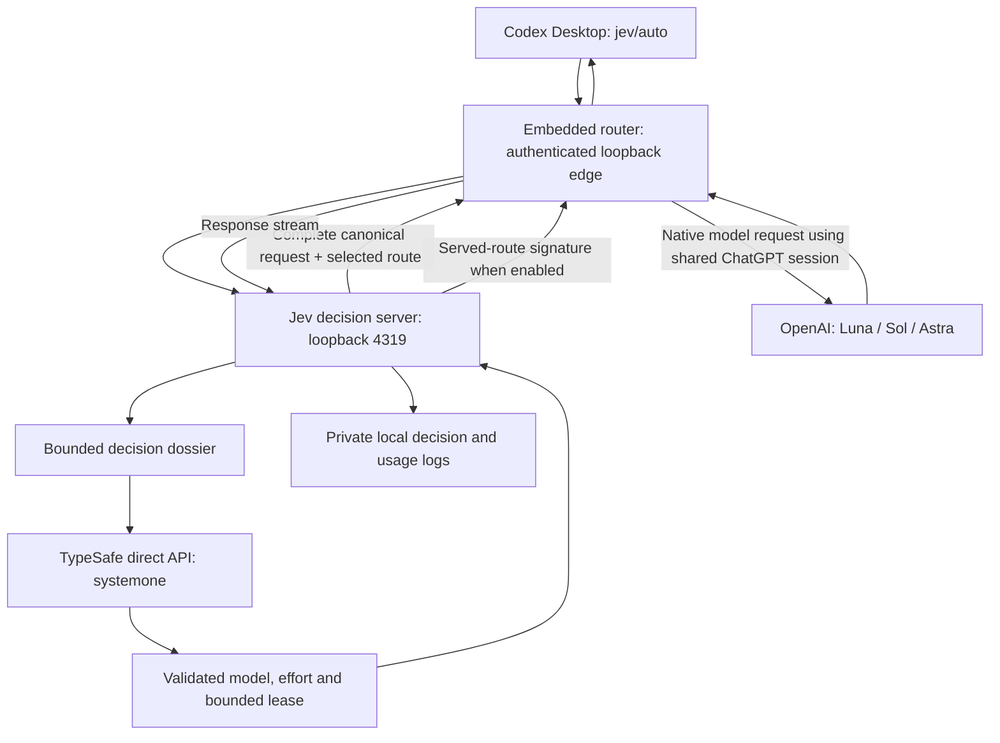
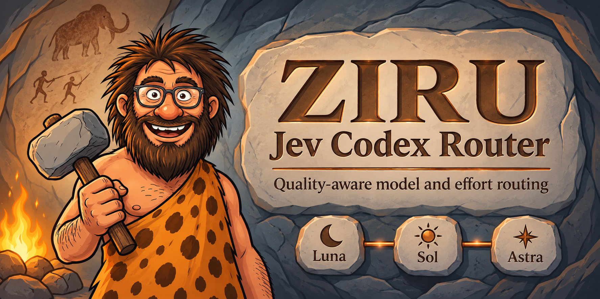
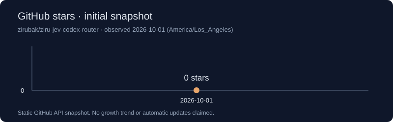

<p align="center"></p>

# ZIRU Jev Codex Router

     

[](https://github.com/zirubak/ziru-jev-codex-router/actions/workflows/ci.yml)

Choose a model and reasoning effort for the task's quality requirements and failure risk, aiming to reduce total tokens across implementation, verification, review and rework.

**Private preview · macOS Codex Desktop** · [한국어](README.ko.md)

## What it does

An optional answer signature shows the served route, for example:

```text
[gpt-6.1-sol / high]
```

The signature appears with the first assistant text, not before upstream reasoning begins. Structured JSON output is excluded. Routing can reuse a bounded decision lease for clean continuations; new user turns, errors, compaction and changed tool chains trigger reassessment.


### Prompt → response examples

These are **illustrative examples, not recorded benchmark runs**. The displayed
route can differ with context, policy and tool results. Enable the signature to
see `[model / effort]`; the answer body is written by Codex, not a fixed router
template. The router does not automatically publish its full decision rationale.

<details open>
<summary>1. Small, bounded change</summary>

**Prompt**
```text
Rename the Save button to Save changes. Check the affected UI only.
```
**Illustrative response**
```text
[gpt-6-luna / low]

I’ll update the button label and check the affected view.
```
</details>

<details>
<summary>2. Debugging with regression verification</summary>

**Prompt**
```text
This endpoint sometimes returns duplicate records. Find the cause,
add a failing regression test, then fix it and run the affected tests.
```
**Illustrative response**
```text
[gpt-6.1-sol / high]

I’ll reproduce the duplicate result, trace the query and retry paths,
and verify the fix with a regression test.
```
</details>

<details>
<summary>3. Independent final review</summary>

**Prompt**
```text
Review the completed authentication change for correctness and security.
Report findings by severity with file references and verification gaps.
```
**Illustrative response**
```text
[gpt-6-astra / high]

I’ll inspect the authentication boundaries, changed tests and failure paths,
then report actionable findings and remaining verification gaps.
```
</details>

<details>
<summary>4. Manual Ultra advice</summary>

**Prompt**
```text
Investigate three independent subsystems and compare their failure evidence.
Would independent parallel exploration materially help this investigation?
```
**Illustrative response** (the advisory is currently rendered in Korean)
```text
[gpt-6-astra / max]

[Jev Ultra 추천] 독립적인 조사·가설 검증을 병렬로 나누면 도움이 될 수 있습니다. Codex 모델 메뉴에서 GPT-6 Astra의 Ultra를 직접 선택하세요. 현재 Ultra는 실행 중이 아닙니다. 지원 클라이언트와 위임 권한이 필요하며, 로컬 Codex에서는 독립 작업의 하위 에이전트 위임을 명시적으로 요청하세요. 토큰 사용량이 늘 수 있습니다.

I’ll first check whether the subsystem investigations are independent.
```
The recommendation does not switch the model or enable delegation. A technical
Jev failure instead uses `[gpt-6.1-sol / high]`; the prefix alone cannot tell
you whether Sol/high was selected normally or used as fallback.
</details>

## Install and first run

Requirements: macOS, Node.js 22.19+, Python 3.11+, a working Codex ChatGPT login, GitHub access to this private repository, and a TypeSafe key in a private `.jev.env` file. The background service needs a permanent internal-disk checkout.

### Ask Codex to install

Copy this prompt into Codex:

```text
Install https://github.com/zirubak/ziru-jev-codex-router on my Mac.
First verify authenticated access to this private repository. Clone it into
~/Documents/GitHub/ziru-jev-codex-router; if that path exists, inspect and preserve
its changes. Read README.md and the project instructions before executing setup.
Check macOS, Node.js >=22.19, Python >=3.11, Codex login, and local port conflicts.
Use my private ~/.jev.env via JEV_ENV_FILE. Never print or copy key values into
chat, command arguments or Git. If the file is missing, ask only for its path.
Use the root ./install.sh transaction and embedded router; do not clone another
router. Preserve unrelated Codex settings and existing services. Stop if an
unknown service owns a required port; do not kill it.
Verify installation with the documented diagnostics and smoke test. Enable the
optional [model / effort] signature. Report checks, any failed restoration and
the exact installed source revision. Let me quit and reopen Codex myself, then
explain how to select Jev Codex Router and return to an ordinary model.
Do not claim a successful installation from a health check alone.
```

### Manual installation

Authenticate GitHub CLI first, then:

```sh
gh repo clone zirubak/ziru-jev-codex-router "$HOME/Documents/GitHub/ziru-jev-codex-router"
cd "$HOME/Documents/GitHub/ziru-jev-codex-router"
chmod 600 "$HOME/.jev.env"
JEV_ENV_FILE="$HOME/.jev.env" ./install.sh
```

Create the private key file using your editor beforehand; it must contain the `TYPESAFE_API_KEY` setting. Never paste its value into an issue or installation prompt. Installation performs a live smoke request and may consume usage. `./install.sh --prepare-only` prepares dependencies without activating services.

Quit and reopen Codex yourself, choose **Jev Codex Router**, then enable the optional signature:

```sh
touch "$HOME/.codex/codex-router/jev-router.signature"
bin/jev-codex-router router status
bin/jev-codex-router router doctor
bin/jev-codex-router smoke
```

## Models, effort and fallback

| Automatic candidate | Efforts |
| --- | --- |
| GPT-6 Luna | low, medium, high, xhigh, max |
| GPT-6.1 Sol | low, medium, high, xhigh, max |
| GPT-6 Astra | low, medium, high, xhigh, max |

The current policy requires Astra for project architecture, independent final code review and risk-focused review. It independently selects effort. Technical Jev failures or missing key/task fall back to **GPT-6.1 Sol / high / Standard**. Kill switch, shadow mode and exhausted native quota have separate existing policies.

Ultra is a **manual recommendation**, not an automatically activated execution mode. The router can advise selecting a native Sol/Astra Ultra option; it does not claim to enable Codex automatic delegation. Research informs routing but is not proof of local quality or savings.

## Costs and measurement limits

The current-policy snapshot contains 887 routed calls: 753 Sol 6.1 and 134 Astra. These are calls, not 887 completed tasks. A bounded lease avoided 321 additional Jev decisions (36.2% of calls); that is **not** a 36.2% total-token or monetary saving.

| Quantity | Observed result |
| --- | --- |
| Calls with observed cache usage | 880; 7 unknown |
| Input tokens on those calls | 133,127,030 |
| Cached input tokens, included in input | 41,673,216 (31.3%) |
| Jev decisions / lease reuses | 566 / 321 |
| Observed Jev input tokens | 1,596,027 |
| Whole-task token savings | unknown |
| Current-policy monetary savings | unknown; current model pricing coverage incomplete |

See [measurement scope](docs/COSTS.md). Subscription fees, Codex credits, API-equivalent estimates and TypeSafe charges are different quantities. No monthly subscription discount is implied. The old approximately 60% simulation in [BACKTEST.md](BACKTEST.md) is historical and does not measure this policy.

## Architecture and data flow



The second pass through the embedded router uses a native model identifier, preventing a recursive `jev/auto` route. Jev receives a bounded dossier, not the entire canonical model request. That dossier can contain user text, recent context and tool excerpts. The selected execution model receives the complete canonical request. TypeSafe requests use `https://api.typesafe.ai/v1/systemone` directly, never Vercel. Local services bind loopback; credentials and logs remain private local state. Do not publish logs or backup contents.

## Operations, troubleshooting and removal

```sh
bin/jev-codex-router report --days 7 --policy current
bin/jev-codex-router update
bin/jev-codex-router router providers generic disable jev
```

Disabling Jev preserves other providers. For full router removal, review [operations](server/INSTALL.md) and the embedded router removal command before acting: other configured clients may share this service. Installation backups contain secrets and must not be committed or blindly copied over newer configuration.

See [support matrix](docs/SUPPORT.md), [release checks](docs/RELEASING.md), [security](SECURITY.md), and [contribution guide](CONTRIBUTING.md).


## Platform limitations and feedback

This preview targets **macOS Codex Desktop**. The maintainer has not performed
manual Windows installation or end-to-end Windows validation. The root installer
uses macOS launchd and is not a supported Windows installer. Portable embedded
router CI is separate from whole-product support; a passing Windows CI job would
not establish Windows installation support.

Windows testers with repository access are welcome to test the portable
`router/` component in an isolated environment and share feedback in
[GitHub Issues](https://github.com/zirubak/ziru-jev-codex-router/issues). Include
your Windows version, Node.js and Codex versions, tested commit, steps to
reproduce, expected and actual behavior, and sanitized errors. Never attach
API keys, authentication files, raw conversations or installation backups.

## Brand preview

The README banner above and the preview below are included in the repository.
GitHub's separate social-preview settings are not a requirement for this release.



## Origins & Credits

Based on [0xNatoshi/jev-codex-router](https://github.com/0xNatoshi/jev-codex-router), base commit `8701ef788aa8cb0948f299538747fb01029d32b8`. Original MIT copyright remains in [LICENSE](LICENSE). Embedded router provenance and its separate MIT license are documented in [ROUTER_FORK.md](ROUTER_FORK.md).

ZIRU extends the upstream implementation with research-informed model and effort routing, GPT-6 Luna / GPT-6.1 Sol / GPT-6 Astra candidates, Sol/high technical fallback, visible route prefixes, manual Ultra recommendations and installation safeguards.

## From ZIRU

Read more about AI-assisted development and the experiments behind this project on [ZIRU’s Medium blog](https://medium.com/@jh.baek.sd). Follow the blog for longer explanations alongside the code and its evidence.

## Stars snapshot

GitHub API snapshot: **0 stars**, checked 2026-10-01 (America/Los_Angeles). This is a static initial snapshot, not a growth trend. It does not auto-update. The CI badge links to the actual workflow; private-repository access restrictions may prevent its remote image from loading.


