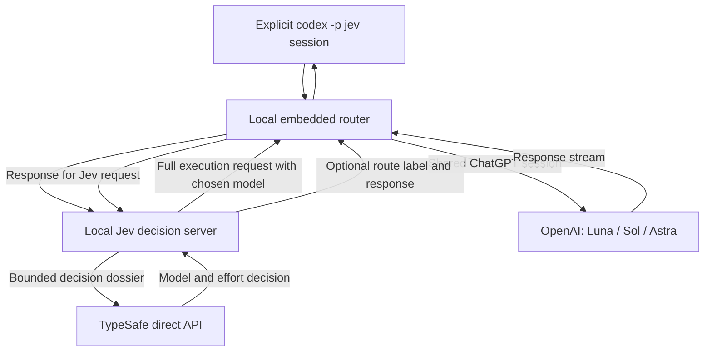

<p align="center"></p>

# ZIRU Jev Codex Router

**Let Codex choose the model and thinking effort for each stage of your work.**

  [](https://github.com/zirubak/ziru-jev-codex-router/actions/workflows/ci.yml)

[한국어](README.ko.md) · [Install](#install) · [Examples](#what-youll-see) · [How it works](#how-it-works) · [Star this project](https://github.com/zirubak/ziru-jev-codex-router/stargazers)

ZIRU exposes **Jev Codex Router** through the explicit `codex -p jev` profile. Select that profile and keep working as usual: ask a question, fix a bug, or build a feature. Jev, from TypeSafe, chooses between **GPT-6 Luna, GPT-6.1 Sol and GPT-6 Astra**, along with how deeply the model should reason.

The aim is to use enough reasoning to do the job well, while avoiding unnecessary token use across coding, tests, reviews and corrections. A small edit and a final security review should not need the same approach.

## Select an isolated profile

1. Install with the root installer below.
2. Run `codex -p jev` to select the Jev model and its dedicated local provider together.
3. Send your usual prompts. With route display enabled, replies include `[gpt-6.1-sol / high]`.

Normal Codex and the Desktop model picker keep their official OpenAI/ChatGPT
provider and catalog. Jev is available only through an explicitly selected
profile; the installer does not override `openai_base_url` or the global
model catalog. Existing threads retain their provider/model identity. Start a
fresh official-model thread for normal use.

See [provider isolation](docs/release/provider-isolation.md) for configuration,
recovery and verification details.

## Install

This is a **private preview for macOS Codex Desktop**. You need access to this repository, a working Codex ChatGPT login, Node.js **22.19+**, Python **3.11+**, and a [TypeSafe API key](https://console.typesafe.ai/keys).

### First, give Jev its little key

Think of the API key as your personal key to Jev. Its home is **`~/.jev.env`**, a small text file on your Mac — not inside this project.


**1. Get the key.** Open the [TypeSafe key page](https://console.typesafe.ai/keys), sign in or create an account, and create an API key. Copy it for the next step. The [official quick start](https://docs.typesafe.ai/introduction/quickstart) links to this page; button names may change.

**2. Make its home.** Open **Terminal** on your Mac (press `Command + Space`, type `Terminal`, then press Return). Run these lines one at a time. They contain no key:

```sh
touch "$HOME/.jev.env"
chmod 600 "$HOME/.jev.env"
nano "$HOME/.jev.env"
```

`touch` creates the file if needed without clearing an existing one. `chmod 600` lets only your Mac user read and write it. `nano` opens a plain-text editor inside Terminal.

In the editor, type this setting name:

```text
TYPESAFE_API_KEY=
```

Paste your copied key **immediately after `=`**, on that same line. Do not leave the value empty. If the setting already exists, replace only its value and preserve other settings. No `export`, extra spaces or second line is needed.

Press **Control + O**, then **Return** to save. Press **Control + X** to exit. These are Control shortcuts, not Command shortcuts.

`~` means your home folder; the dot makes `.jev.env` a hidden file. For example, it lives at `/Users/YOUR_MAC_USERNAME/.jev.env`. Keep the exact filename: **`.jev.env`, not `.jev.env.txt`**. Already have a working file? Keep it and skip creating another one.

**3. Let Codex do the rest.** Paste the installation prompt below. Tell Codex only that the file is ready — **never paste the key into chat, an issue or a terminal command**. The installer checks the file, and its live smoke test checks the connection. You can now go back to building something fun.

The service runs from its checkout, so install on a permanent internal-disk path.

### Ask Codex to set it up

Paste this into Codex:

```text
Install https://github.com/zirubak/ziru-jev-codex-router on my Mac.
Read its README and project instructions first. Verify authenticated access
and clone it to ~/Documents/GitHub/ziru-jev-codex-router, preserving any
existing checkout and local changes.
Check macOS, Node.js 22.19+, Python 3.11+, Codex login and required ports.
Use my private ~/.jev.env through JEV_ENV_FILE. Never print or copy key
values into chat, command arguments or Git. If it is missing, ask for the
private file's location; if I have no key yet, guide me through obtaining one.
Run the root ./install.sh with its embedded router and rollback safeguards.
Preserve unrelated settings and services. Stop and report unknown port
owners instead of terminating them.
Enable the [model / effort] display. Run the documented status, doctor and
smoke checks; a health check alone is not proof of successful installation.
Report the installed revision, check results and any restoration failure.
Do not restart Codex. Show me how to select codex -p jev explicitly and verify
a fresh ordinary-model chat remains on the official provider.
```

Installation includes a live smoke request and may consume usage. No app restart is performed.

<details>
<summary><strong>Prefer to install from Terminal?</strong></summary>

Authenticate GitHub CLI and prepare the private key file first. If the destination already exists, inspect it before proceeding.

```sh
gh repo clone zirubak/ziru-jev-codex-router "$HOME/Documents/GitHub/ziru-jev-codex-router"
cd "$HOME/Documents/GitHub/ziru-jev-codex-router"
chmod 600 "$HOME/.jev.env"
JEV_ENV_FILE="$HOME/.jev.env" ./install.sh
```

Enable route labels and check the installation from the repository root:

```sh
touch "$HOME/.codex/codex-router/jev-router.signature"
bin/jev-codex-router router status
bin/jev-codex-router router doctor
bin/jev-codex-router smoke
```

Run `codex -p jev` to select **Jev Codex Router** explicitly. To prepare dependencies without activating services, use `./install.sh --prepare-only`. See the [operations guide](server/INSTALL.md) for installation details and recovery.

</details>

## What you'll see

These examples illustrate the response format, **not recorded test results or guaranteed model choices**. Context and tool results affect routing. Codex writes the response body; Jev selects the route and does not automatically explain its full reasoning.

**A small change**

> Rename the Save button to Save changes. Check that it fits in the dialog.

```text
[gpt-6-luna / low]

I’ll update the label and check the dialog layout.
```

**A bug to investigate**

> This endpoint sometimes returns duplicate records. Find the cause, add a failing test, and fix it.

```text
[gpt-6.1-sol / high]

I’ll reproduce the duplicate result, trace the query and retry paths,
and check the fix with a regression test.
```

**A final review**

> Review the completed login change for correctness and security. Include file references for any issues.

```text
[gpt-6-astra / high]

I’ll inspect the authentication boundaries and failure paths, then report
findings by severity with file references.
```

Labels appear with the first text of each assistant message; they are not shown before upstream reasoning begins. Structured JSON output is excluded. You may see a different route after a tool call or a new request.

## How it chooses

*Effort* is the model's reasoning-depth setting. Jev considers the remaining work, failure risk and available evidence, using the project's [routing policy](server/routing_policy.py) and [research reference](server/routing_reference.py).

| Automatic candidate | Intended role | Available efforts |
| --- | --- | --- |
| GPT-6 Luna | Small, bounded changes with checkable results | low · medium · high · xhigh · max |
| GPT-6.1 Sol | General implementation and debugging | low · medium · high · xhigh · max |
| GPT-6 Astra | Architecture, independent final review and risk-focused review | low · medium · high · xhigh · max |

The current policy requires Astra for the review and architecture categories above; effort is chosen separately. Within a clean continuation, a decision can be reused within a bounded continuation. New user requests, errors, compaction and changes in the tool chain trigger reassessment.

In native Plan mode, Jev prioritizes an implementation-ready plan and chooses
capability, reasoning depth and a review recommendation for the remaining
uncertainty and risk. Substantive plans receive bounded completion guidance;
small clerical edits can stay lightweight. Parallel review is conditional on
the caller's tools and authority, and the router does not launch agents or
certify their work. See [adaptive planning validation](docs/release/adaptive-planning.md).

**If Jev has a technical failure**, or the key/task is missing, execution falls back to **GPT-6.1 Sol / high / Standard**. A Sol/high label alone cannot distinguish a normal choice from fallback; the local diagnostics provide that detail. Kill switch, shadow mode and exhausted model quota have [separate handling](server/INSTALL.md).

**Ultra requires your choice.** When independent parallel work could help, the router can recommend selecting a native Sol or Astra Ultra option. The current advisory is in Korean. It does not switch modes or enable delegation for you; client support and delegation permission are still required. Ultra can use more tokens.

## Will it save money?

That is the goal, but **we do not yet have a reliable savings percentage** for the current policy. Lower effort or a smaller model can reduce usage on some calls; extra reasoning, retries and Jev decisions can offset that. The useful comparison is the cost of finishing the whole task at the required quality.

The 2026-10-01 observation contains **887 routed calls**, not 887 completed tasks:

| Measurement | Observed result |
| --- | --- |
| Model choices | Sol 6.1: 753 · Astra: 134 |
| Jev decisions / reused decisions | 566 / 321 |
| Input tokens on 880 calls with usage data | 133,127,030, including 41,673,216 cached tokens |
| Observed Jev input tokens | 1,596,027 |
| Whole-task token savings / monetary savings | Unknown / unknown |

Reusing 321 decisions avoided a Jev call on 36.2% of routed calls. **This is not a 36.2% token or cost saving.** Seven calls lack cache-usage data, and pricing and task-level measurements are incomplete. [Measurement details and calculation method](docs/COSTS.md).

Codex subscription fees, usage credits, API-equivalent estimates and TypeSafe charges are separate. Reduced usage does not lower a fixed monthly subscription fee. The older [approximately 60% simulation](BACKTEST.md) is historical, not a result for this policy.

## How it works



TypeSafe receives a **bounded decision dossier** that can include user text, recent context and tool excerpts. The selected OpenAI model receives the **complete canonical execution request**, so routing does not replace its context with that dossier. The native model ID on the second pass prevents recursive Jev routing.

Jev calls go directly to `https://api.typesafe.ai/v1/systemone`, never through Vercel. The local services listen on loopback addresses. Credentials, decision logs and usage logs are stored locally; do not publish those files or installation backups. See [security guidance](SECURITY.md).

## Help and documentation

Start with `bin/jev-codex-router router doctor` if the model is missing or requests fail. The [operations guide](server/INSTALL.md) covers diagnosis, updates, disabling Jev and full removal, including shared-service precautions and installation recovery.

| Guide | Contents |
| --- | --- |
| [Operations](server/INSTALL.md) | Install, diagnose, update and uninstall |
| [Support](docs/SUPPORT.md) | Supported environment and validation limits |
| [Costs](docs/COSTS.md) | What was measured and what remains unknown |
| [Contributing](CONTRIBUTING.md) | Tests and contributions |
| [Releases](docs/RELEASING.md) | Release checks; Star History setup deferred until public release |

**Windows is unverified.** The maintainer has not tested Windows installation or end-to-end use. The root installer uses macOS launchd; portable `router/` CI does not establish Windows product support. Windows testers are welcome to try that component in an isolated environment and [share feedback](https://github.com/zirubak/ziru-jev-codex-router/issues). Include OS, Node.js and Codex versions, commit, reproduction steps and sanitized errors. Leave out keys, authentication files, raw conversations and backups.

## Origins and ZIRU

Based on [0xNatoshi/jev-codex-router](https://github.com/0xNatoshi/jev-codex-router), commit `8701ef788aa8cb0948f299538747fb01029d32b8`. Original MIT notices are retained in [LICENSE](LICENSE); the embedded router's source and separate license are recorded in [ROUTER_FORK.md](ROUTER_FORK.md).

ZIRU adds the research-informed routing policy, current three-model selection, Sol/high technical fallback, visible route labels, manual Ultra advice and installation safeguards.

For the experiments and practical AI-coding lessons behind this project, visit [ZIRU on Medium](https://medium.com/@jh.baek.sd). The [project sharing image](docs/assets/social-preview.png) is also included in this repository.
